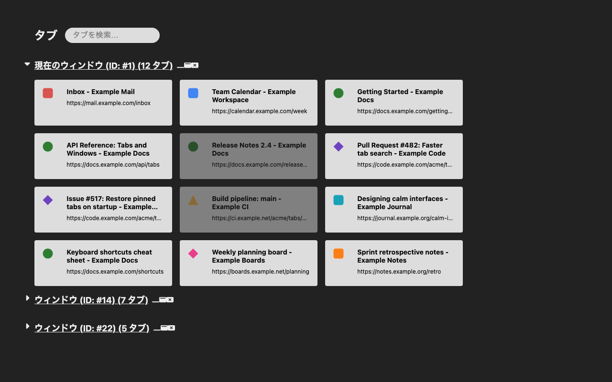

# Urzk Tab Manager

[English](README.md) | 日本語

新しいタブのページを、すべてのウィンドウで開いているタブの一覧に置き換える Chrome 拡張機能です。タブが 1000 枚を超えても、すばやく見つけて、整理して、閉じられます。



## 機能

- **すべてのウィンドウをひと目で。** 現在のウィンドウを先頭に展開して表示します。ほかのウィンドウは開閉でき、ウィンドウごとに最小化・フォーカス・閉じるボタンがあります。
- **タブカード。** ファビコン、タイトル、URL を表示します。カードをクリックするか Enter キーを押すと、そのタブに切り替わります。破棄（メモリから解放）されたタブは薄く表示されます。
- **クイック操作。** カードにマウスを乗せると表示されます。タブの破棄、閉じる、新しいウィンドウへの切り出し、現在のウィンドウの末尾への移動、上下左右への移動ができます。キーボードでは、フォーカス中のタブに Enter キーで切り替え、矢印キーで移動できます。
- **検索。** タイトル、サイト、読み込み状態で絞り込めます（下記参照）。
- **ツールバーボタンとショートカット。** マネージャーを開きます。すでに開いている場合はそのタブに切り替えます。
- **大量のタブでも正確。** Chrome のタブのイベントに追従し、定期的に Chrome の状態と照合します。ずれが生じても、操作が止まってから約 0.5 秒、遅くとも 30 秒以内に修正されます。
- **英語と日本語**の UI（ブラウザの言語設定に従います）。

## 検索の文法

ページ上部の検索欄に入力します。

| 入力 | 一致するタブ |
|---|---|
| `foo bar` | タイトルに `foo`、続いて `bar` をこの順に含むタブ。大文字と小文字は区別しません。 |
| `site:example.com` | URL のホストが `example.com`、またはそのサブドメイン（`docs.example.com` など）のタブ。 |
| `loaded:` または `l:` | 読み込み済み（破棄されていない）タブのみ。 |

組み合わせて使えます（例: `site:example.com l: release notes`）。検索中は、一致するタブがないウィンドウは表示されず、移動ボタンは無効になります。

## キーボードショートカット

**Alt+Shift+T** を押す（またはツールバーボタンをクリックする）と、マネージャーを開きます。すでにどこかのタブで開いている場合は、そのタブとウィンドウにフォーカスします。ショートカットを変更するには `chrome://extensions/shortcuts` を開きます。

タブカード上では、**Enter** でそのタブに切り替え、**矢印キー**でタブを移動します。

## 権限

| 権限 | 用途 |
|---|---|
| `tabs` | 開いているタブのタイトルと URL を読み取り、一覧表示・検索・管理（切り替え、移動、破棄、閉じる）に使います。 |
| `favicon` | ページ自身のアイコンを取得できないときに、Chrome がキャッシュしているファビコンを表示します。 |

ホスト権限、ストレージ、リモートコードは使いません。タブの情報はメモリ上でのみ扱い、保存も送信もしません。詳しくは[プライバシーポリシー](PRIVACY.md#日本語)をご覧ください。

## インストール

- **Chrome ウェブストア:** 公開準備中です。
- **リリースから:** [GitHub Releases](https://github.com/urzk/urzk-tab-manager/releases) から `urzk-tab-manager-<version>.zip` をダウンロードして展開します。`chrome://extensions` を開き、**デベロッパー モード**をオンにして、**パッケージ化されていない拡張機能を読み込む**から展開したフォルダを選びます。

## 開発

必要なもの: Node 24 と pnpm（`package.json` の `packageManager` のバージョン。`corepack enable` で有効にします）。

```sh
pnpm install
pnpm dev:mock      # ダミーのタブを使ったデモページ http://localhost:5174（?lang=ja で日本語）
pnpm build         # 拡張機能を dist/ にビルド
```

実際の拡張機能として試すには、`pnpm build` を実行し、`chrome://extensions` で**デベロッパー モード**をオンにして、**パッケージ化されていない拡張機能を読み込む**から `dist/` を選びます。

そのほかのスクリプト:

| スクリプト | 内容 |
|---|---|
| `pnpm test` | 単体・プロパティ・コンポーネントテストを実行（vitest） |
| `pnpm check` | svelte-check と tsc で型チェック |
| `pnpm lint` | ESLint を実行 |
| `pnpm package` | ビルドして `dist/` を `release/urzk-tab-manager-<version>.zip` に圧縮 |
| `pnpm icons` | `assets/*.svg` から `public/icons/*.png` とストア用プロモーションタイルを書き出す |
| `pnpm build:mock` | デモページを `dist-mock/` にビルド |

バージョンは `package.json` だけで管理し、ビルド時に `dist/manifest.json` に書き込まれます。

### リリース

1. [CHANGELOG.md](CHANGELOG.md) の `## [Unreleased]` に変更内容を書いてコミットします。
2. `pnpm release:patch`、`pnpm release:minor`、`pnpm release:major` のいずれかを実行します。`package.json` のバージョンを上げ、Unreleased の内容を新しいバージョンの節に移し、コミットしてローカルに tag `vX.Y.Z` を付けます。
3. `git push && git push --tags` で push します。リリース用ワークフローが tag と `package.json` のバージョンの一致を確認してからビルドし、`release/urzk-tab-manager-<version>.zip` を GitHub Release に添付します。
4. その zip を Chrome ウェブストアのデベロッパー ダッシュボードに手動でアップロードします。掲載文は [store/en.md](store/en.md) と [store/ja.md](store/ja.md)、画像は [store/](store) にあります。

### 計測

`scripts/open-many-tabs.sh` で 1000 枚以上のタブを開く方法と、計測する項目（メモリ、DOM ノード数、描画までの時間）、計測結果は [docs/benchmarks.md](docs/benchmarks.md) にあります（英語）。

### 手動確認チェックリスト

リリースの前に、ビルドした `dist/` を Chrome に読み込んで確認します。

- [ ] **パッケージ化されていない拡張機能を読み込む**で `dist/` をエラーなく読み込め、新しいタブを開くとマネージャーが表示される。
- [ ] 1000 タブ（`scripts/open-many-tabs.sh dist 1000 4`）でメモリ、DOM ノード数、描画までの時間を計測し、[docs/benchmarks.md](docs/benchmarks.md) に記録する。
- [ ] ツールバーボタンでマネージャーが開く。すでに開いている場合はそのタブにフォーカスする。
- [ ] Alt+Shift+T でも同じ動作をし、`chrome://extensions/shortcuts` でショートカットを変更できる。
- [ ] ブラウザの言語が英語のとき、UI が英語で表示される。
- [ ] ブラウザの言語が日本語のとき、UI が日本語で表示される。
- [ ] タブのウィンドウ間の移動（切り出し、現在のウィンドウの末尾への移動、Chrome のタブバーでのドラッグ）が一覧に反映される。
- [ ] マネージャーからウィンドウを最小化でき、一覧に反映される。
- [ ] マネージャーからウィンドウやタブを閉じられ、一覧に反映される。

## プライバシー

Urzk Tab Manager は、データを一切収集・保存・送信しません。[PRIVACY.md](PRIVACY.md#日本語) をご覧ください。

## クレジット

アイコンは [Font Awesome Free](https://fontawesome.com)（@fontawesome、CC BY 4.0）を元にしています。

## ライセンス

作者: Urozuki。[GPL-3.0-or-later](LICENSE) のもとで公開しています。
