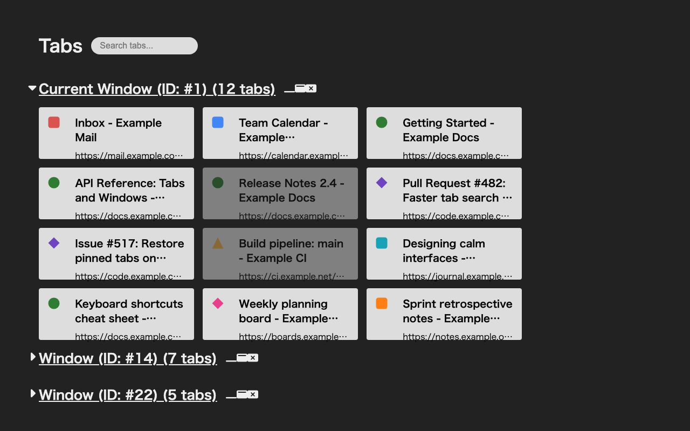

# Urzk Tab Manager

English | [日本語](README.ja.md)

A Chrome extension that replaces the new tab page with an overview of every
open tab in every window, so you can find, organize and close tabs quickly,
even with more than 1000 of them.



## Features

- **Every window at a glance.** The current window is listed first and
  expanded. Other windows can be expanded or collapsed, and each window has
  buttons to minimize, focus or close it.
- **Tab cards** with favicon, title and URL. Click a card or press Enter to
  switch to that tab. Discarded (unloaded) tabs are dimmed.
- **Quick actions** appear when you hover over a card or focus it with the
  keyboard: discard, close, pop out to a new window, move to the end of the
  current window, and move up, down, left or right. Arrow keys move the
  focused tab too.
- **Search** by title, site and load state (see below).
- **Toolbar button and shortcut** to open the manager, or focus it if it is
  already open.
- **Accurate with many tabs.** The page follows Chrome's tab events and
  regularly checks itself against Chrome, so any drift is corrected about half
  a second after activity stops, and within 30 seconds at most.
- **English and Japanese** UI, following the browser language.

## Search syntax

Type into the search box at the top of the page.

| Input | Matches |
|---|---|
| `foo bar` | Tabs whose title contains `foo` and then `bar`, in that order. Case-insensitive. |
| `site:example.com` | Tabs whose URL host is `example.com` or a subdomain of it, such as `docs.example.com`. |
| `loaded:` or `l:` | Only tabs that are loaded (not discarded). |

Terms can be combined, for example `site:example.com l: release notes`.
While searching, windows with no matching tabs are hidden, and the move
buttons are disabled.

## Keyboard shortcut

Press **Alt+Shift+T** (or click the toolbar button) to open the manager. If
it is already open in some tab, that tab and its window are focused instead.
To change the shortcut, open `chrome://extensions/shortcuts`.

On a tab card: **Enter** switches to the tab, and the **arrow keys** move it.

## Permissions

| Permission | Why |
|---|---|
| `tabs` | Read the titles and URLs of open tabs to list, search and manage them (switch, move, discard, close). |
| `favicon` | Show the favicons Chrome has cached when a page's own icon is unavailable. |

No host permissions, no storage and no remote code. Tab information stays in
memory and is never stored or sent anywhere. See the
[privacy policy](PRIVACY.md).

## Install

- **Chrome Web Store:** coming soon.
- **From a release:** download `urzk-tab-manager-<version>.zip` from
  [GitHub Releases](https://github.com/urzk/urzk-tab-manager/releases), unzip
  it, then open `chrome://extensions`, turn on **Developer mode**, click
  **Load unpacked** and select the unzipped folder.

## Development

Requirements: Node 24 and pnpm (the version in `packageManager` in
`package.json`; run `corepack enable`).

```sh
pnpm install
pnpm dev:mock      # demo page with fake tabs at http://localhost:5174 (add ?lang=ja for Japanese)
pnpm build         # build the extension into dist/
```

To try the real extension, run `pnpm build`, open `chrome://extensions`, turn
on **Developer mode**, click **Load unpacked** and select `dist/`.

Other scripts:

| Script | What it does |
|---|---|
| `pnpm test` | Run the unit, property and component tests (vitest). |
| `pnpm check` | Type-check with svelte-check and tsc. |
| `pnpm lint` | Run ESLint. |
| `pnpm package` | Build and zip `dist/` into `release/urzk-tab-manager-<version>.zip`. |
| `pnpm icons` | Render `assets/*.svg` to `public/icons/*.png` and the store promo tile. |
| `pnpm build:mock` | Build the demo page into `dist-mock/`. |

The version lives only in `package.json`; the build injects it into
`dist/manifest.json`.

### Release

1. Add entries under `## [Unreleased]` in [CHANGELOG.md](CHANGELOG.md) and
   commit them.
2. Run `pnpm release:patch`, `pnpm release:minor` or `pnpm release:major`.
   This bumps the version in `package.json`, moves the Unreleased notes under
   the new version, commits, and tags `vX.Y.Z` locally.
3. Push: `git push && git push --tags`. The release workflow checks that the
   tag matches `package.json`, builds, and attaches
   `release/urzk-tab-manager-<version>.zip` to a GitHub Release.
4. Upload that zip to the Chrome Web Store Developer Dashboard by hand. The
   listing text is in [store/en.md](store/en.md) and [store/ja.md](store/ja.md),
   and the images are in [store/](store).

### Benchmarks

How to open 1000+ tabs with `scripts/open-many-tabs.sh` and what to measure
(memory, DOM node count, time to render) is described in
[docs/benchmarks.md](docs/benchmarks.md), along with the recorded results.

### Manual test checklist

Run through this before each release, with the built `dist/` loaded in Chrome.

- [ ] `dist/` loads in Chrome via **Load unpacked** without errors, and opening a new tab shows the manager.
- [ ] With 1000 tabs (`scripts/open-many-tabs.sh dist 1000 4`), measure memory, DOM node count and time to render, and record them in [docs/benchmarks.md](docs/benchmarks.md).
- [ ] The toolbar button opens the manager, or focuses it if it is already open.
- [ ] Alt+Shift+T does the same, and the shortcut can be changed at `chrome://extensions/shortcuts`.
- [ ] With the browser language set to English, the UI is in English.
- [ ] With the browser language set to Japanese, the UI is in Japanese.
- [ ] Moving a tab to another window (pop out, move to end of current window, or dragging in Chrome's tab strip) is reflected in the list.
- [ ] Minimizing a window from the manager works, and the list reflects it.
- [ ] Closing a window or a tab from the manager works, and the list reflects it.

## Privacy

Urzk Tab Manager does not collect, store or transmit any data. See
[PRIVACY.md](PRIVACY.md).

## Attribution

Icons are derived from [Font Awesome Free](https://fontawesome.com) by
@fontawesome, licensed under CC BY 4.0.

## License

By Urozuki. Licensed under [GPL-3.0-or-later](LICENSE).
