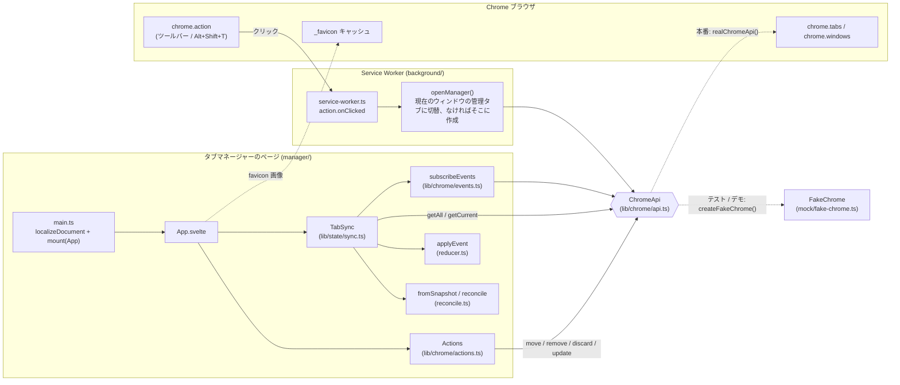
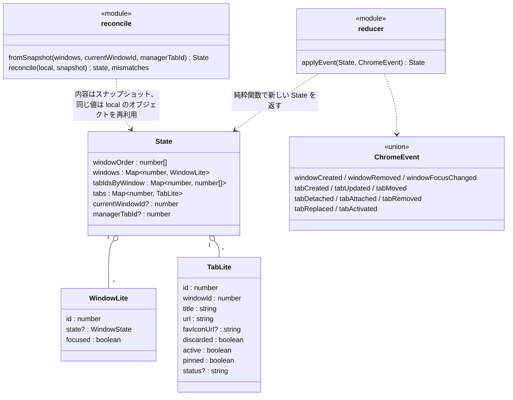
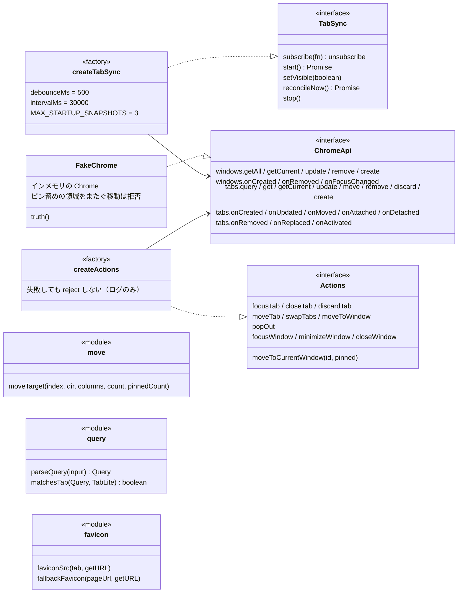
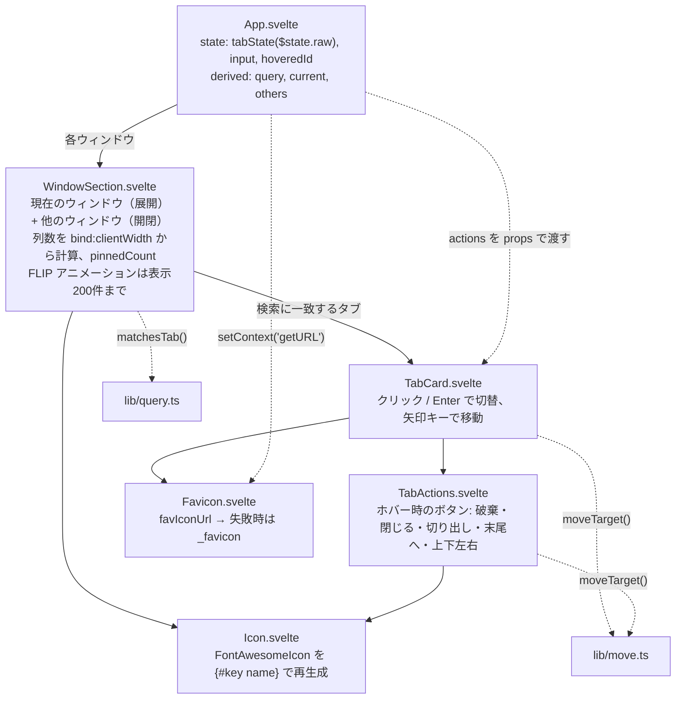
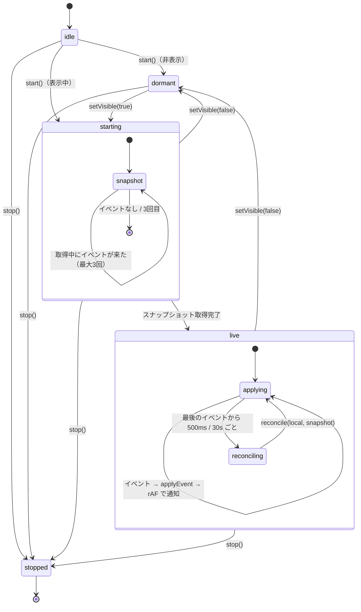
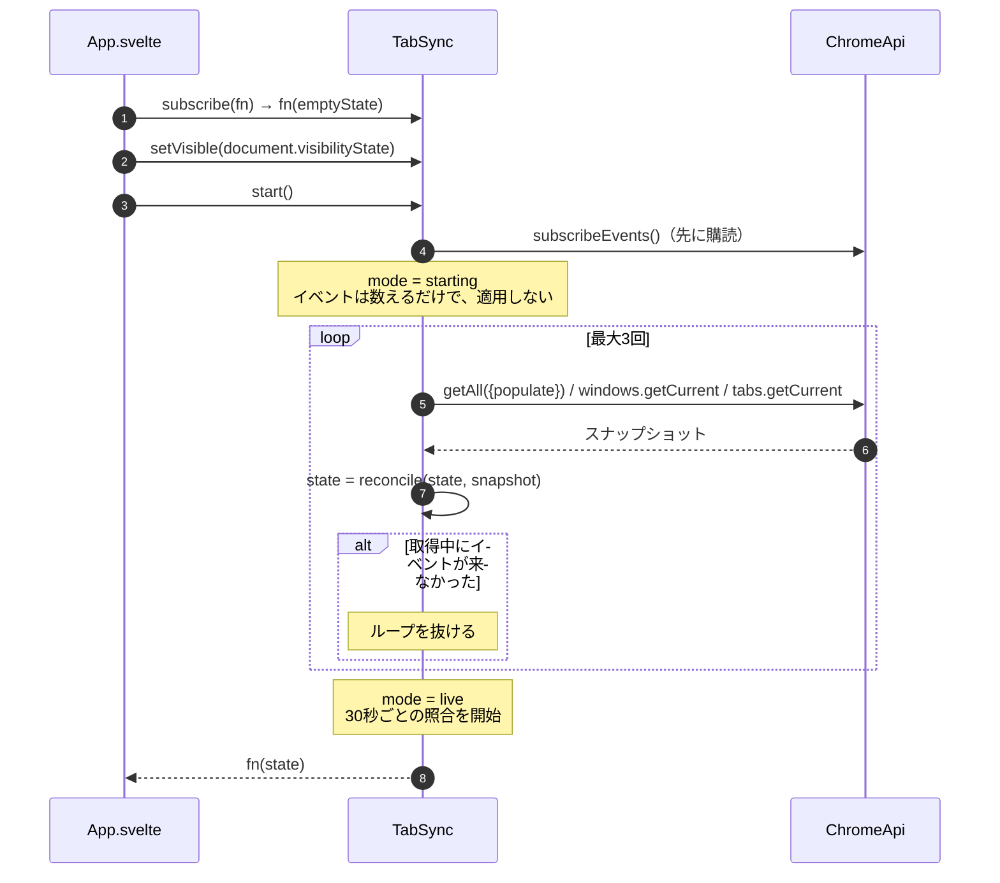
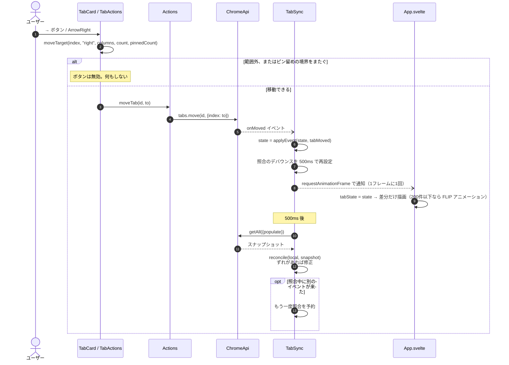
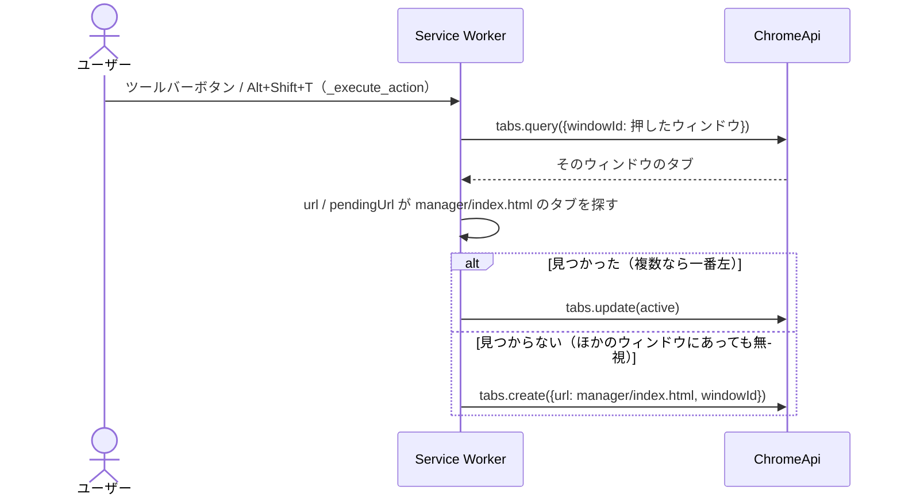
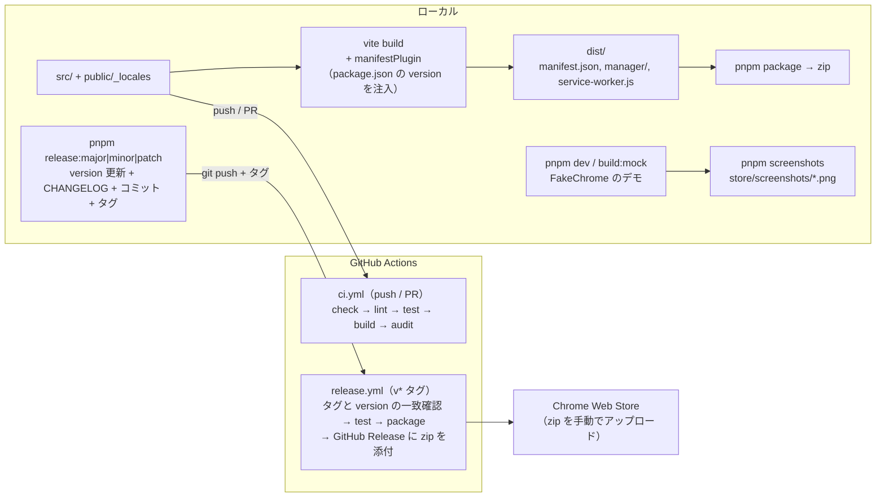

# アーキテクチャ

Urzk Tab Manager 1.0 の設計を図で示します。図は Mermaid で書いており、GitHub 上でそのまま描画されます。

## 1. 全体構成

拡張機能は、タブマネージャーのページと Service Worker の2つのエントリポイントでできています。マネージャーはツールバーボタンか Alt+Shift+T で開き、新しいタブのページは置き換えません。Chrome API には、必ず `ChromeApi` インターフェース経由でアクセスします。そのため、テストやデモでは本物の Chrome をインメモリの `FakeChrome` に差し替えられます。

## 2. 状態モデル

`State` は不変（イミュータブル）です。イベントのたびに新しいオブジェクトを作ります。変わっていないタブやウィンドウは同じオブジェクトをそのまま使い回すので、Svelte の keyed リストは変わった部分だけを描き直します。

## 3. モジュールとインターフェース

## 4. UI コンポーネント

## 5. TabSync の状態遷移

ページが非表示のあいだは「休止」状態になり、イベントの購読もタイマーもすべて外します。休止に入るときや停止するときは `generation` を1つ進めます。こうすることで、途中だった非同期処理の結果は捨てられます。

## 6. 起動シーケンス

## 7. 操作と同期の流れ（例: タブを右へ移動）

UI は Chrome の結果を待たずに楽観的に書き換えることはしません。Chrome が発火したイベントを反映して表示を更新します。万一イベントの取りこぼしや競合があっても、照合（reconcile）で Chrome の実際の状態に戻ります。

## 8. ツールバーボタン / ショートカット

## 9. ビルドとリリース

